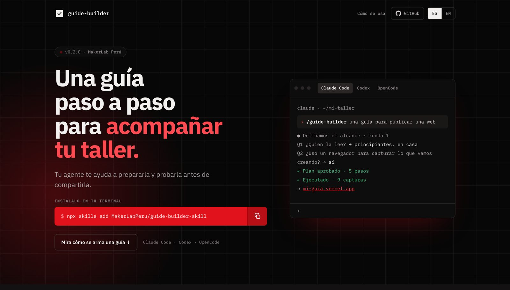
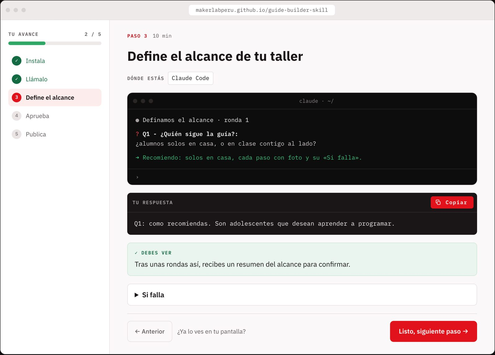
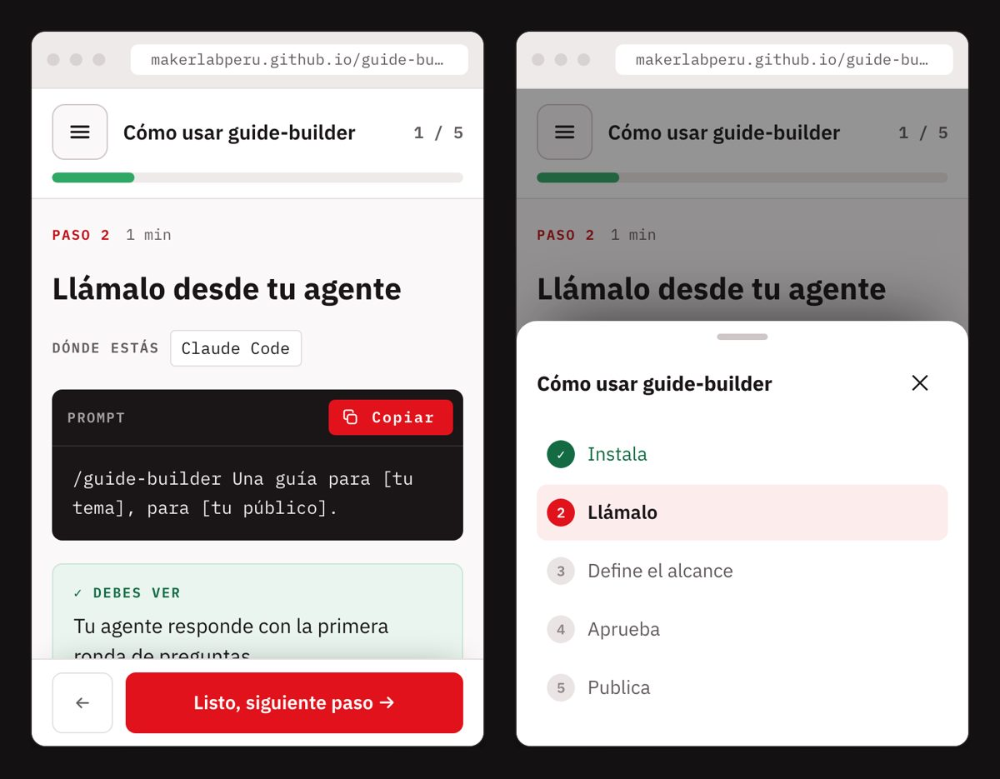

<p align="center">
  
</p>

<h1 align="center">guide-builder</h1>

<p align="center">Una guía paso a paso para acompañar tu taller.</p>

<p align="center"><a href="README.md">English</a> · <a href="https://makerlabperu.github.io/guide-builder-skill/">Web</a></p>

<p align="center">
  <a href="https://makerlabperu.github.io/guide-builder-skill/"></a>
</p>

---

Un skill para tu agente de IA que te ayuda a preparar una guía paso a paso para tu taller. Tu agente define el alcance contigo, ejecuta cada paso de verdad, toma las capturas y publica una página que tu grupo sigue a su ritmo.

## Instalación

```sh
npx skills add MakerLabPeru/guide-builder-skill
```

## Actualizar

Para pasar a la última versión:

```sh
npx skills update guide-builder
```

Los cambios están en [CHANGELOG.md](CHANGELOG.md).

## Cómo se usa

| Agente | Cómo llamarlo |
|---|---|
| Claude Code | `/guide-builder Una guía para [tu tema], para [tu público].` |
| Codex | `$guide-builder Una guía para [tu tema], para [tu público].` |
| OpenCode | `/guide-builder Una guía para [tu tema], para [tu público].` |

## Cómo es una guía

Todos los pasos tienen la misma forma: **Dónde estás · Haz esto · Prompt o comando · Debes ver · Si falla**, con botones de copiar, barra de avance y un botón **Listo, siguiente paso**. Se avanza un paso a la vez y al final hay confeti.



En el celular, la lista de pasos pasa a una hoja y **Listo, siguiente paso** queda al alcance del pulgar.

<p align="center"></p>

Pruébala en la [web](https://makerlabperu.github.io/guide-builder-skill/#como).

## Créditos

- Hecho en [MakerLab Perú](https://www.makerlabperu.org/).
- Las preguntas para definir el alcance se inspiran en [grill-me](https://github.com/mattpocock/skills/tree/main/skills/productivity/grill-me) de Matt Pocock (MIT).

## Licencia

[MIT](LICENSE)
