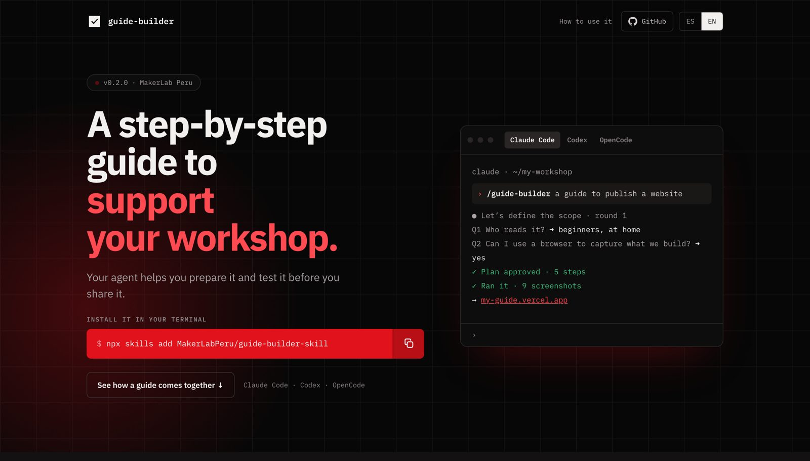
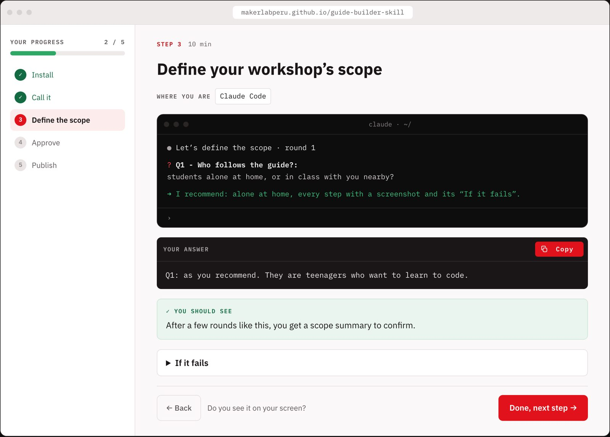
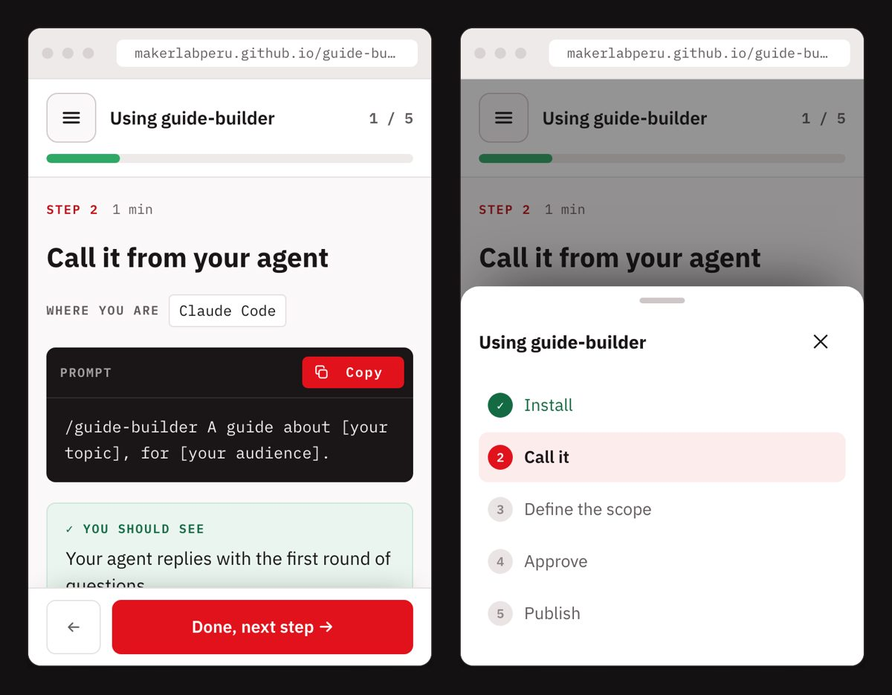

<p align="center">
  
</p>

<h1 align="center">guide-builder</h1>

<p align="center">A step-by-step guide to support your workshop.</p>

<p align="center"><a href="README.es.md">Español</a> · <a href="https://makerlabperu.github.io/guide-builder-skill/en/">Website</a></p>

<p align="center">
  <a href="https://makerlabperu.github.io/guide-builder-skill/en/"></a>
</p>

---

An agent skill that helps you prepare a step-by-step guide for your workshop. Your agent defines the scope with you, runs every step for real, takes the screenshots and publishes a page your group can follow at their own pace.

## Install

```sh
npx skills add MakerLabPeru/guide-builder-skill
```

## Update

Update to the latest version:

```sh
npx skills update guide-builder
```

Changes are listed in [CHANGELOG.md](CHANGELOG.md).

## Use it

| Agent | How to call it |
|---|---|
| Claude Code | `/guide-builder A guide about [your topic], for [your audience].` |
| Codex | `$guide-builder A guide about [your topic], for [your audience].` |
| OpenCode | `/guide-builder A guide about [your topic], for [your audience].` |

## What a guide looks like

Every step has the same shape: **Where you are · Do this · Prompt or command · You should see · If it fails**, with copy buttons, a progress bar and a **Done, next step** button. Readers go one step at a time and get confetti at the end.



On phones, the step list moves to a sheet and **Done, next step** stays within thumb reach.

<p align="center"></p>

Try it on the [website](https://makerlabperu.github.io/guide-builder-skill/en/#como).

## Credits

- Built at [MakerLab Perú](https://www.makerlabperu.org/).
- The scoping questions are inspired by [grill-me](https://github.com/mattpocock/skills/tree/main/skills/productivity/grill-me) by Matt Pocock (MIT).

## License

[MIT](LICENSE)
